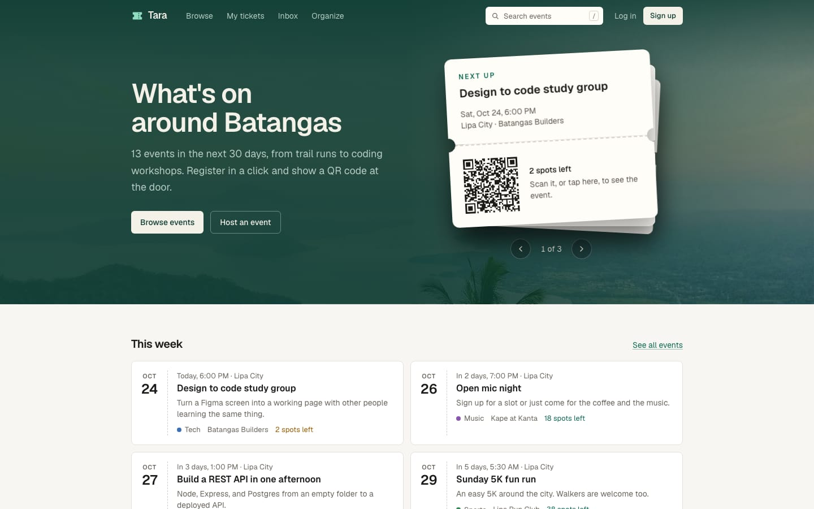
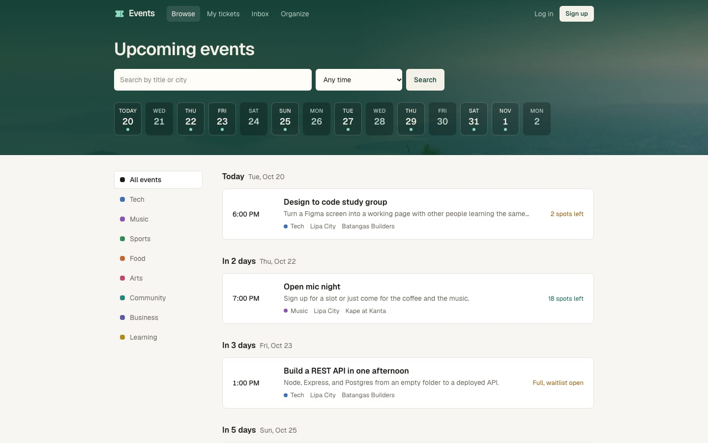
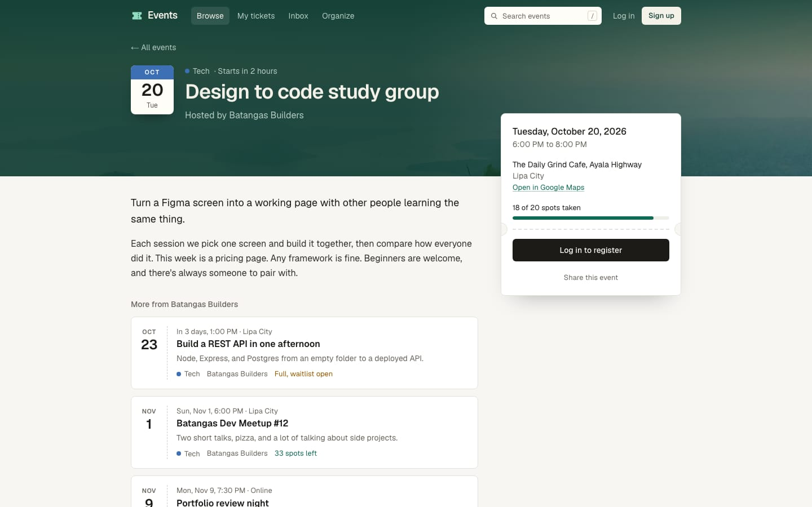
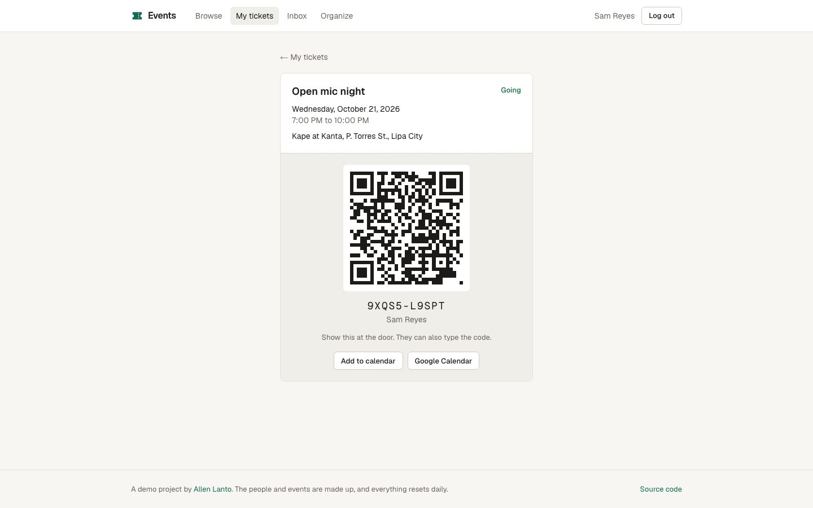
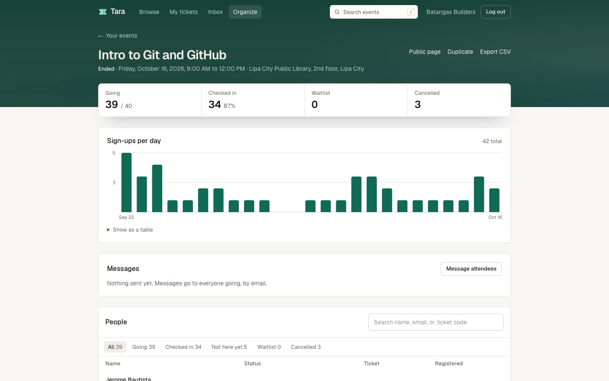
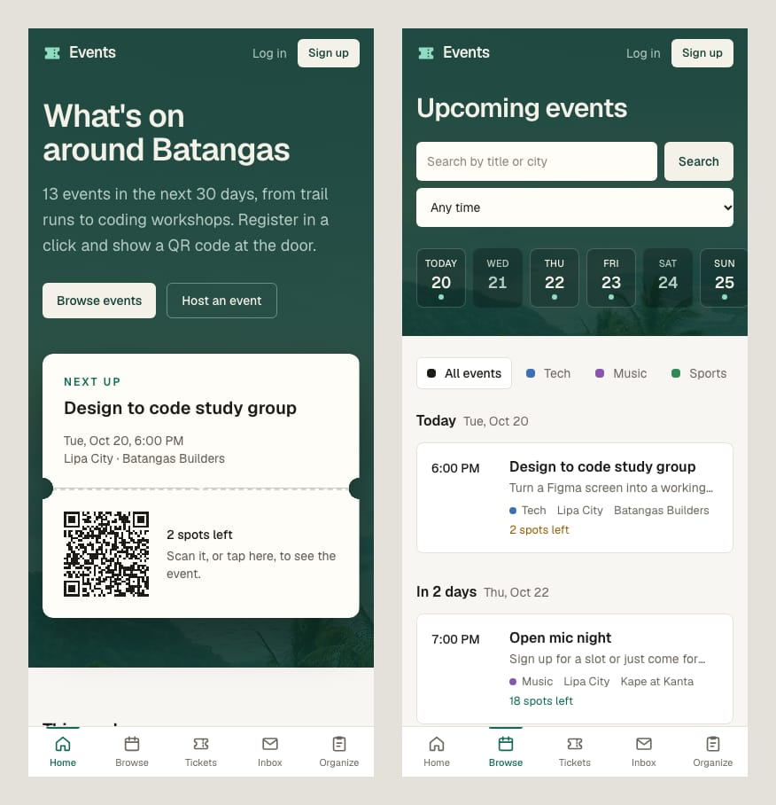
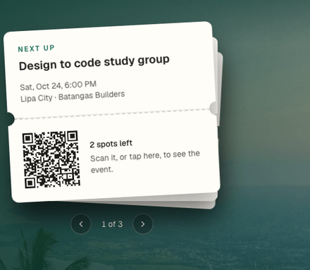
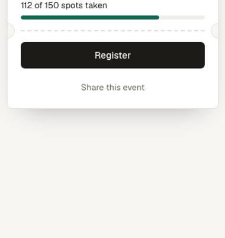
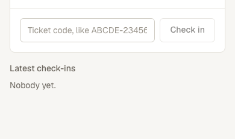

# Tara

Tara is Filipino for "let's go", what you say when you invite someone along. It's an event registration app for free events: meetups, workshops, runs, school org events. People browse events, register, and get a QR ticket. Organizers create events, see who's coming, message attendees, and check people in at the door by scanning tickets with their phone.

The live link runs in demo mode: the people and events are made up, the data resets every day, and you can sign in as a sample attendee or organizer from the login page. With demo mode off, the same code runs as a normal app with real accounts (see [Using it for real](#using-it-for-real)).

**Live demo:** https://tara-events.vercel.app



| Browsing by day | An event page |
| --- | --- |
|  |  |

| A ticket with its QR code | The organizer dashboard |
| --- | --- |
|  |  |



## How it feels to use

The home page shows the next three events as a pile of paper tickets. Drag the top one away, or use the arrows, and it goes to the back.



When you register, your ticket feeds out of a slot like a ticket printer. If the event is full, you see the line instead: the door, the people ahead of you, and you at the back.



At the door, the check-in page stamps each ticket: admitted, already in, or no entry.



## What it does

**For attendees**
- Browse upcoming events by day, filter by category, or pick a day from a strip of the next two weeks
- Search by title or city. The list updates as you type, and pressing / on any page jumps to the search box
- Event pages count down to the start ("Starts in 3 hours") and show when an event is happening now
- On phones, the main links sit in a tab bar along the bottom of the screen
- Register in one click. When an event is full you join the waitlist and see your place in line
- Get a ticket with a QR code. Online events only show the meeting link once you have a confirmed spot
- Cancel or leave the waitlist. If you give up a spot, the next person in line gets it automatically
- Add an event to Apple Calendar, Outlook, or Google Calendar, and open the venue in Google Maps
- An inbox page keeps a copy of every email the app sends you
- Account settings: change your name or password, reset a forgotten password by email, or delete your account

**For organizers**
- Create events as drafts or publish right away, edit them, cancel them
- A dashboard with going, waitlist, checked-in, and cancelled counts, plus a chart of sign-ups per day
- Attendee list with filters and search, and a CSV export
- A check-in page that scans QR tickets with the phone camera, or takes the code typed in by hand. It catches tickets that were already used, cancelled, still waitlisted, or for a different event
- Message everyone going (and optionally the waitlist) by email, limited to 5 messages an hour per event
- Unlisted events that stay out of browse and search but work for anyone with the link
- Duplicate an event as a new draft for recurring meetups
- Raising the capacity moves people off the waitlist. Changing the time or place emails everyone

## How it's built

- **Next.js 16** (App Router, React Server Components) and **Tailwind CSS**
- **Hono** for the API, mounted at `/api` inside Next. The pages call it in process from the server and over HTTP from the browser, through Hono's typed client, so the UI and the API share one set of types
- **PostgreSQL** with **Drizzle ORM** and SQL migrations. Locally and in tests it runs on **PGlite** (Postgres compiled to WebAssembly), so there's nothing to install
- **Zod** for request validation, **Vitest** for tests, **GitHub Actions** for CI
- Auth is written by hand: scrypt password hashes, random session tokens stored as SHA-256 hashes, httpOnly cookies

```text
src/
  app/                  pages, plus app/api/[[...route]] which hands requests to Hono
  components/           UI pieces; organizer/ holds the dashboard, form, and scanner
  lib/                  typed API clients, date helpers (all times are Manila time)
  server/
    app.ts              the Hono app: middleware, routes, error handling
    routes/             auth, events, organizer, me, cron
    services/           the actual logic: registrations, waitlist, check-in, stats, emails
    db/                 schema and database connections
    seed.ts             the sample data
    test/               API tests
drizzle/                generated SQL migrations
```

## Parts worth a closer look

**No overselling.** Registering locks the event row (`SELECT ... FOR UPDATE`) before counting seats, so two people can't both take the last one. A test fires 20 registrations at a 5-seat event at the same time and checks that exactly 5 are confirmed and the other 15 are waitlisted in order. CI runs it against a real Postgres server too.

**Waitlist order.** The waitlist is ordered by a database sequence, not a timestamp. Timestamps can tie when people sign up at the same moment, and a sequence can't.

**Emails saved with the change that caused them.** Emails are written to an `emails` table in the same transaction as the registration or cancellation, then sent after it commits. If the transaction rolls back, no email goes out. Without a Resend key they just stay in the table, which is what the demo inbox reads.

**CSV export that's safe to open.** Names starting with `=`, `+`, `-`, or `@` get a leading apostrophe so spreadsheet apps don't run them as formulas. There's a test with a `=HYPERLINK(...)` name.

**Tests hit the real API.** The tests send HTTP requests to the Hono app backed by a fresh Postgres per test file: auth, rate limiting, CSRF, waitlist promotion, permissions, check-in rules, stats, and the export. Run them with `npm test`.

## Running it locally

Needs Node 20.9 or newer.

```bash
npm install
npm run dev
```

Open http://localhost:3000. The first request creates a local database in `.data/` and loads the sample data. To start over, stop the dev server and run `npm run db:reset`.

Other commands:

```bash
npm test            # API tests
npm run typecheck
npm run lint
npm run db:generate # new migration after editing src/server/db/schema.ts
```

## Using it for real

Demo mode is controlled by `DEMO_MODE`:

- `DEMO_MODE=true`: loads the sample data, shows the one-click sample accounts, and lets the daily cron job reset everything. This is what the live link uses.
- `DEMO_MODE=false`: a normal app. No sample data is ever loaded, there are no sample accounts, and the reset endpoint refuses to run, so a real database can't be wiped by accident.
- Unset: on for local development without a database, off everywhere else.

For real use you'll also want email, since confirmations, reminders, password resets, and organizer messages all go out by email. Add `RESEND_API_KEY` and `EMAIL_FROM` from a free [Resend](https://resend.com) account with a verified domain. Without it, emails are only kept on each person's inbox page and password reset links can't be sent.

What it doesn't do: paid tickets, multiple ticket types, or co-organizers. Event times are in Philippine time.

## Deploying for free

Import the repo on [Vercel](https://vercel.com) (Hobby plan) and add `CRON_SECRET` (any long random string) and `DEMO_MODE` as environment variables. Two daily cron jobs send reminders for the next day's events and, in demo mode, reset the data at midnight Manila time.

**Without a database.** If `DATABASE_URL` isn't set, the API runs an in-memory Postgres (PGlite) and loads the sample data when it starts. Treat this as a quick preview only: Vercel spreads requests across several server instances, each with its own copy of the data, so sign-ins and registrations go missing at random. Add a real database before sharing the link.

**With a database.** Create a free Postgres database on [Neon](https://neon.tech), copy the pooled connection string, and add it as `DATABASE_URL`. On the next deploy the build applies migrations, and in demo mode loads the sample data if the database is empty (see `vercel.json`).
